# EVALS — Automated Eval Dataset Generator from Production Logs

> Turn production LLM traffic into continuously improving, human-reviewed evaluation datasets.

EVALS ingests raw production logs (JSONL, JSON, CSV, OpenAI-style chat logs, or plain
`key=value` application logs), redacts PII and secrets, rebuilds multi-turn conversations,
flags failures with **explicit evidence levels**, removes near-duplicates, clusters similar
interactions, and generates versioned evaluation datasets that a human reviews before export.

It runs entirely locally: **no paid LLM API, no cloud services, no GPU required.**

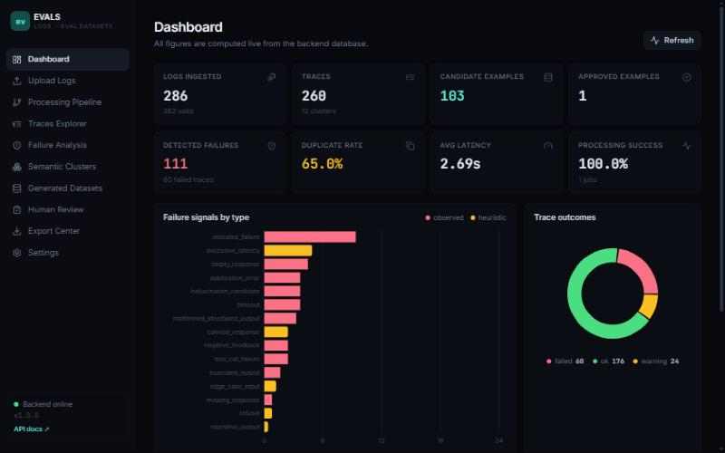

---

## 1. Problem statement

AI teams collect thousands of production interactions, but converting them into evaluation
datasets is slow, manual and inconsistent. Engineers copy-paste failing chats into
spreadsheets, PII leaks into test fixtures, the same question appears 400 times, and nobody
can say where an "expected answer" came from.

## 2. Why EVALS matters

| Problem | What EVALS does |
| --- | --- |
| Logs come in many shapes | One normalised schema for 5 input formats, with field aliasing |
| PII and secrets in logs | Redaction **before** anything is stored; raw text never logged or exported |
| Failures are buried | 15 failure detectors, each labelled `observed` or `heuristic` |
| Massive redundancy | Exact + normalised + TF-IDF (or embedding) similarity deduplication |
| "Expected output" is guessed | Strict provenance: `none` → `candidate` → `human_approved` |
| Opaque quality | 7 named, weighted quality factors shown for every example |
| Datasets drift | Versioned datasets with snapshots and annotation history |

The core honesty rule: **production logs contain what the model said, not what it should
have said.** EVALS never invents a ground-truth answer. An expected output is either absent,
a *candidate* from a defensible source (a reference field in the log, an answer that received
explicit positive user feedback, or an optional LLM suggester), or approved by a human.

## 3. Architecture

```
 Production logs (.jsonl .json .csv .log)
        │
        ▼
 ┌──────────────┐  validate size/extension/encoding, sniff format
 │  Ingestion   │──────────────────────────────────────────────┐
 └──────┬───────┘                                              │
        ▼                                                      │ ProcessingEvent
 ┌──────────────┐  map field aliases → NormalizedRecord        │ per stage
 │ Parse/Normal.│  (trace id, turn, input, output, latency…)   │ (timing, counts,
 └──────┬───────┘                                              │  errors)
        ▼                                                      │
 ┌──────────────┐  regex + validators (Luhn, IPv4), sensitive  │
 │ PII redaction│  metadata keys, custom patterns              │
 └──────┬───────┘                                              │
        ▼                                                      │
 ┌──────────────┐  group by trace, order by turn/timestamp,    │
 │Reconstruction│  pair request/response, detect gaps          │
 └──────┬───────┘                                              │
        ▼                                                      │
 ┌──────────────┐  15 detectors, evidence = observed|heuristic │
 │Failure detect│                                              │
 └──────┬───────┘                                              │
        ▼                                                      │
 ┌──────────────┐  exact hash → normalised hash → cosine sim   │
 │ Deduplication│  (TF-IDF char n-grams or sentence-transformers)
 └──────┬───────┘                                              │
        ▼                                                      │
 ┌──────────────┐  TF-IDF + K-means (silhouette-chosen k) or   │
 │  Clustering  │  DBSCAN; top terms + representative trace    │
 └──────┬───────┘◄─────────────────────────────────────────────┘
        ▼
 ┌──────────────┐  category mapping, expected-output provenance,
 │ Example gen. │  confidence, explainable quality score
 └──────┬───────┘
        ▼
 ┌──────────────┐  approve / reject / flag / edit / notes,
 │ Human review │  full annotation history, re-scoring
 └──────┬───────┘
        ▼
 Versioned dataset ──► validated JSONL / CSV / JSON export (+ manifest)
```

Backend: FastAPI → services → independent pipeline modules → SQLAlchemy → SQLite
(PostgreSQL-compatible schema, Alembic migrations). Frontend: React SPA talking to the REST
API. Details in [docs/ARCHITECTURE.md](docs/ARCHITECTURE.md) and
[docs/DATA_PIPELINE.md](docs/DATA_PIPELINE.md).

## 4. Core features

- **Ingestion** — JSONL, JSON (an array, or an object holding one under `logs`, `records`,
  `data`, `items`, `events`, `traces` or `interactions`), CSV,
  OpenAI chat-completion logs (`messages` + `choices`), generic `key=value` application logs.
  Malformed rows are counted and reported, not silently dropped.
- **Privacy** — emails, phone numbers, credit cards (Luhn-checked), SSNs, IPv4/IPv6,
  OpenAI/AWS/GitHub/Slack/Google/Stripe keys, JWTs, bearer tokens, private-key blocks,
  `password=`-style assignments, configurable sensitive metadata keys and custom regexes.
  Live redaction preview on the Settings page.
- **Reconstruction** — multi-turn conversations, request/response pairing (including split
  request and response records), missing-response and incomplete-trace detection.
- **Failure detection** — `application_error`, `timeout`, `empty_response`,
  `missing_response`, `malformed_structured_output`, `tool_call_failure`, `truncated_output`,
  `negative_feedback`, `hallucination_candidate` (only from user feedback that says so),
  `repeated_failure` (observed); `excessive_latency`, `repetitive_output`, `canned_response`,
  `refusal`, `edge_case_input` (heuristic).
- **Deduplication** — exact, normalised-text and similarity matching with a configurable
  threshold; optional sentence-transformers backend with automatic TF-IDF fallback.
- **Clustering** — TF-IDF + K-means (k chosen by silhouette score) or DBSCAN; cluster
  sizes, top terms and representative examples.
- **Dataset generation** — 10 built-in categories plus custom ones; filter by categories,
  minimum quality, failures-only, duplicate exclusion.
- **Explainable quality scoring** — completeness, duplicate probability, input validity,
  output validity, trace completeness, label confidence, review status.
- **Human review** — approve, reject, flag uncertain, reset, edit expected output and
  category, notes, search, status/category filters, bulk review, annotation history.
- **Export** — JSONL / CSV / JSON, approved-only or all, category, status and date-range
  filters; every record validated against a schema; CSV formula-injection protection.
- **Versioning** — dataset versions with immutable example snapshots.

## 5. Technology stack

| Layer | Technology (exact pinned versions in `backend/requirements.txt`, `frontend/package.json`) |
| --- | --- |
| API | Python 3.11+, FastAPI 0.162, Pydantic 2.14, Uvicorn 0.54 |
| Data | SQLAlchemy 2.1, Alembic 1.20, SQLite (PostgreSQL-compatible) |
| Processing | pandas 3.1, NumPy 2.4, scikit-learn 1.9, optional sentence-transformers |
| Frontend | React 19, React Router 7, TypeScript 5.8, Vite 6, Tailwind CSS 4, Recharts 3, lucide-react |
| Testing | pytest 9, pytest-cov, HTTPX/TestClient, Vitest 4, Testing Library, Playwright (E2E) |
| Quality | ruff, mypy, ESLint 9, `tsc` |
| DevOps | Docker, Docker Compose, GitHub Actions |

## 6. Project structure

```
EVALS/
├── backend/
│   ├── app/
│   │   ├── api/routes/      # ingestion, traces/failures/clusters, datasets/examples/exports, system
│   │   ├── core/            # settings, logging, security (admin key, filename sanitising)
│   │   ├── database/        # engine, sessions, migration runner
│   │   ├── models/          # SQLAlchemy entities (12 tables)
│   │   ├── schemas/         # Pydantic request/response models
│   │   ├── ingestion/       # validation, format parsers, normaliser
│   │   ├── privacy/         # redactor + record-level redaction
│   │   ├── processing/      # reconstruction, failures, dedup, clustering, embeddings
│   │   ├── evaluation/      # categories, generator, scoring, exporters, optional LLM
│   │   ├── services/        # pipeline orchestration, datasets/review/export, settings
│   │   └── main.py
│   ├── alembic/             # migrations
│   ├── tests/               # unit / api / integration / security
│   └── requirements*.txt
├── frontend/src/            # pages (11), components, API client, tests
├── sample_data/             # SYNTHETIC logs in 4 formats
├── scripts/                 # sample-data generator, E2E browser check
├── benchmarks/              # benchmark script + recorded results
├── docs/                    # architecture, pipeline, API, testing, security, decisions, screenshots
├── docker/                  # Dockerfiles + nginx config
├── .github/workflows/ci.yml
├── docker-compose.yml
└── .env.example
```

## 7. Installation (Windows)

Prerequisites: **Python 3.11 or 3.12** (3.11+ is required by NumPy 2.4 / pandas 3.1),
**Node.js 20 or 22**, Git. Check in PowerShell:

```powershell
python --version
node --version
npm --version
git --version
```

> Tip: keep the project in a path without spaces or special characters, e.g. `D:\EVALS`.

### Backend

```powershell
cd D:\EVALS\backend
python -m venv .venv
.\.venv\Scripts\Activate.ps1
# If activation is blocked:  Set-ExecutionPolicy -Scope CurrentUser RemoteSigned
python -m pip install --upgrade pip
pip install -r requirements-dev.txt
```

### Frontend

```powershell
cd D:\EVALS\frontend
npm ci
```

## 8. Start the backend

```powershell
cd D:\EVALS\backend
.\.venv\Scripts\Activate.ps1
uvicorn app.main:app --reload --port 8000
```

The SQLite database is created and migrated automatically at `backend\data\evals.db`.
Check <http://127.0.0.1:8000/health> and the interactive API docs at <http://127.0.0.1:8000/docs>.

## 9. Start the frontend

In a second PowerShell window:

```powershell
cd D:\EVALS\frontend
npm run dev
```

Open <http://localhost:5173>. The dev server proxies `/api` to the backend on port 8000.

## 10. Docker

```powershell
cd D:\EVALS
docker compose up --build
```

Frontend: <http://localhost:8080> · API: <http://localhost:8000/docs>. Data persists in the
`evals-data` volume. (The Dockerfiles have not been built in the author's verification
environment — see [Limitations](#17-limitations).)

## 11. Sample data

All sample data is **synthetic**, generated by `scripts/generate_sample_data.py`. Names,
emails, phone numbers and API keys are fabricated and belong to no one.

| File | Format | Contents |
| --- | --- | --- |
| `production_logs.jsonl` | JSONL | 286 records: successes, timeouts, empty responses, tool failures, hallucination feedback, PII, long conversations, repeated requests, malformed lines |
| `openai_chat_logs.json` | JSON | OpenAI chat-completion style logs |
| `support_bot_logs.csv` | CSV | Support-bot interactions with feedback columns |
| `app_server.log` | key=value | Generic application server log lines |

Load one from the dashboard ("Load synthetic sample data"), the Upload page, or the API:
`POST /api/v1/ingestion/sample?name=production_logs`. Regenerate with
`python scripts/generate_sample_data.py`.

## 12. API

Interactive OpenAPI docs at `/docs`. Main endpoints (full reference in [docs/API.md](docs/API.md)):

```
POST  /api/v1/ingestion/upload            GET  /api/v1/datasets
POST  /api/v1/ingestion/sample            POST /api/v1/datasets/generate
GET   /api/v1/ingestion/jobs              GET  /api/v1/datasets/{id}
GET   /api/v1/traces                      GET  /api/v1/datasets/{id}/examples
GET   /api/v1/traces/{trace_id}           PATCH /api/v1/examples/{id}
GET   /api/v1/failures                    POST /api/v1/examples/{id}/review
GET   /api/v1/clusters                    GET  /api/v1/exports/{dataset_id}
GET   /api/v1/dashboard/metrics           GET  /health
```

Exported JSONL record (one per line):

```json
{"id": "…", "input": "How do I reset my password?", "messages": [...], "system_prompt": "…",
 "actual_output": "…", "expected_output": "…", "expected_output_source": "human_approved",
 "category": "correctness", "failure_type": null, "failure_evidence": "none",
 "review_status": "approved", "confidence_score": 0.75, "quality_score": 0.96,
 "source_trace_id": "tr_00026", "source_timestamp": "…", "metadata": {...}}
```

## 13. Testing

```powershell
cd D:\EVALS\backend; .\.venv\Scripts\Activate.ps1
pytest --cov=app --cov-report=term          # 157 tests (1 is POSIX-only and skipped on Windows)
ruff check . ; ruff format --check . ; mypy app

cd D:\EVALS\frontend
npm test ; npm run lint ; npm run typecheck ; npm run build
```

End-to-end browser check against running servers. Start the backend on an **empty**
database first (stop it, then delete or rename `backend\data\evals.db`, or point
`EVALS_DATABASE_URL` at a new file). The check approves, rejects, flags and edits examples,
reloads the browser to confirm persistence, and validates JSONL / CSV / JSON exports:

```powershell
cd D:\EVALS ; backend\.venv\Scripts\Activate.ps1
pip install playwright ; python -m playwright install chromium
python scripts\e2e_browser_check.py --url http://localhost:5173 --api http://127.0.0.1:8000
# add --screenshots to regenerate docs\screenshots\*.png
```

Latest recorded results (Linux VM, 2026-11-06): **157/157 backend tests passed, 96.7% line
coverage; 22/22 frontend tests passed; lint, type-checks and production build clean; E2E
browser check passed with 0 console errors.** Results on Windows: see
[docs/TESTING.md](docs/TESTING.md).

## 14. Benchmarking

```powershell
python benchmarks\run_benchmark.py                     # 1k, 5k, 20k records
python benchmarks\run_benchmark.py --sizes 1000 50000
```

Recorded run — 2 vCPU x86_64 VM @ 2.1 GHz, 7.8 GB RAM, Linux, Python 3.11.18, TF-IDF
similarity (no embeddings), synthetic data:

| Records | File | Unique traces | Full pipeline (DB) | Ingestion rate | Dataset generation |
| ---: | ---: | ---: | ---: | ---: | ---: |
| 858 | 0.5 MB | 47 | 0.69 s | 1,237 rec/s | 0.07 s |
| 4,862 | 2.9 MB | 47 | 3.02 s | 1,607 rec/s | 0.55 s |
| 20,020 | 11.8 MB | 47 | 13.86 s | 1,445 rec/s | 1.92 s |
| 858 (diverse) | 0.5 MB | 753 | 0.77 s | 1,112 rec/s | 0.21 s |
| 4,862 (diverse) | 3.0 MB | 4,206 | 5.29 s | 919 rec/s | 1.51 s |
| 10,010 (diverse) | 6.2 MB | 8,587 | 11.46 s | 874 rec/s | 4.24 s |

The first three runs reuse a small set of templates (highly redundant traffic, so only 47
unique traces survive dedup); the "diverse" runs use mostly-unique inputs, the worst case for
dedup and clustering. Raw results with per-stage timings and memory:
[benchmarks/results/vm.json](benchmarks/results/vm.json). Numbers on your machine will differ.

## 15. Screenshots

| | |
| --- | --- |
| 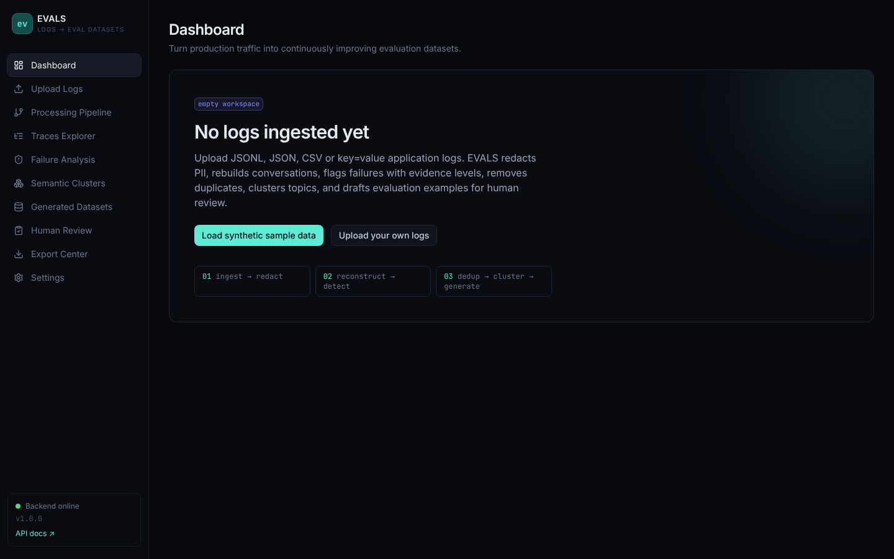 Empty state | 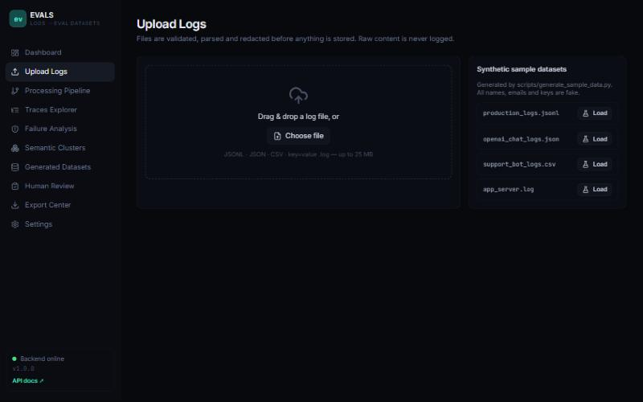 Upload |
| 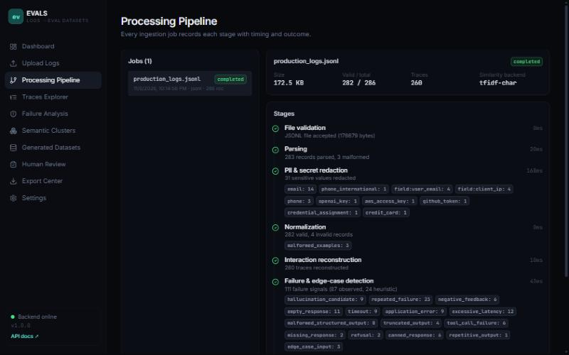 Processing pipeline | 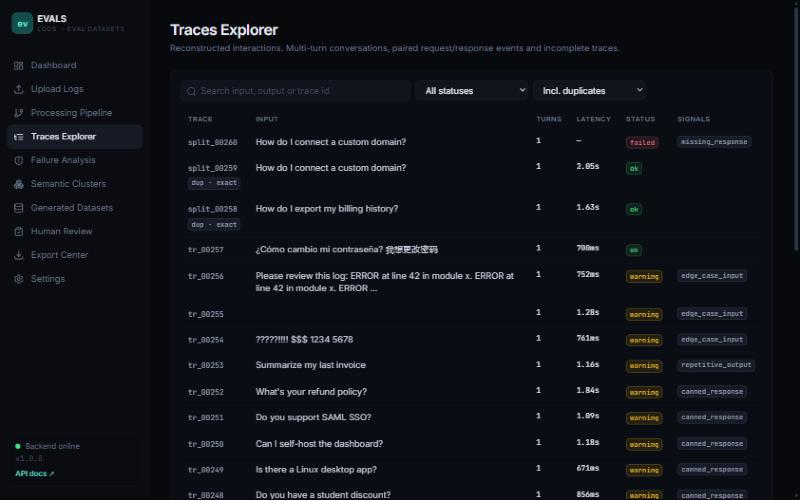 Traces explorer |
| 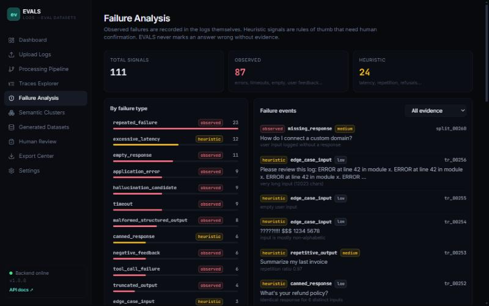 Failure analysis | 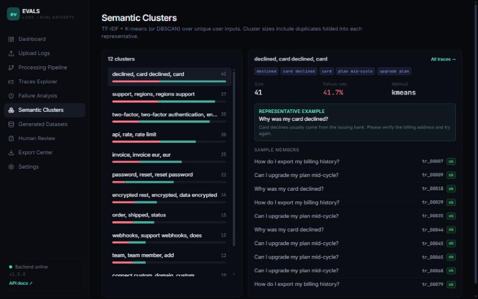 Semantic clusters |
| 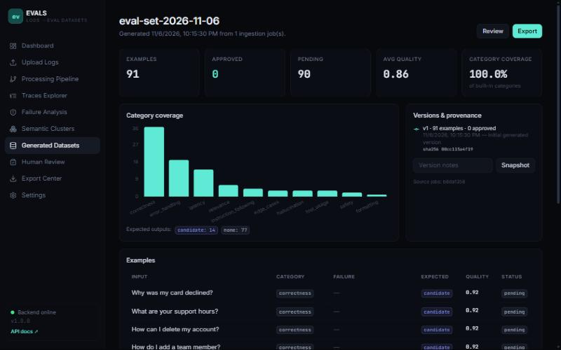 Dataset details | 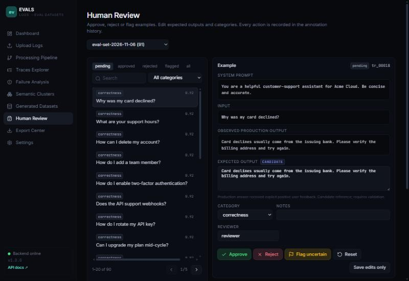 Human review |
| 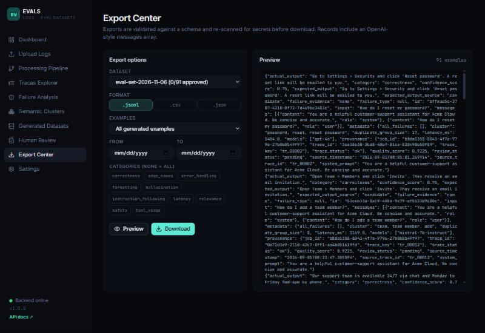 Export center | 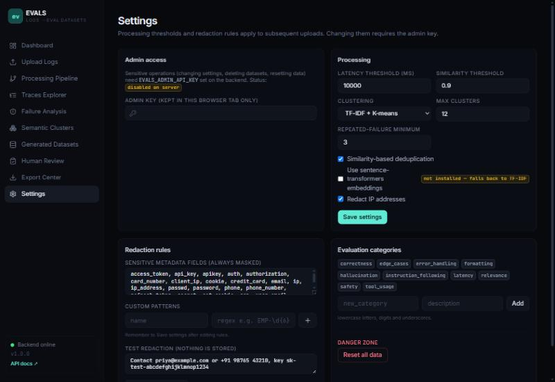 Settings |

## 16. Security summary

Redaction happens before persistence; uploaded content is never logged; filenames are
sanitised; uploads are size-, extension-, encoding-, record-count- and nesting-depth-limited; destructive
operations require `EVALS_ADMIN_API_KEY` (disabled when unset); exports are schema-validated
and protected against CSV formula injection. See [docs/SECURITY.md](docs/SECURITY.md).

## 17. Limitations

- **No user authentication.** Read, upload and review endpoints are open; EVALS is designed
  as a local / trusted-network tool. Only destructive operations are key-protected.
- **Regex-based PII detection** misses free-form PII such as names and street addresses.
- **Heuristic failures are signals, not verdicts**; EVALS cannot judge factual correctness.
- **Synchronous processing**: uploads are processed in the request (fine up to the 25 MB
  default limit; a task queue would be needed for larger files).
- **Dedup and clustering are per upload.** The same traffic arriving in two separate uploads
  is not merged, and clusters are not comparable across uploads.
- **Docker images and the PostgreSQL path are untested** in the verification environment
  (Docker Hub was not reachable there; PostgreSQL also needs `pip install psycopg[binary]`).
- **A generation filter that matches nothing creates an empty dataset** (0 examples) rather
  than returning an error.
- **Frontend dev-dependency advisories:** `npm audit` reports 7 moderate findings, all from one
  `minimatch` advisory inside the ESLint toolchain (`typescript-eslint`). No fixed version is
  available within typescript-eslint 8.x; the production bundle has 0 known vulnerabilities
  (`npm audit --omit=dev`). See [docs/SECURITY.md](docs/SECURITY.md#dependency-audit).
- Benchmarks were recorded on a Linux VM, not on Windows.

## 18. Future improvements

- Background job queue (RQ/Celery) with progress streaming for large uploads
- Authentication and per-reviewer accounts, inter-annotator agreement
- NER-based PII detection (e.g. Presidio) as an optional layer
- Incremental clustering and approximate nearest-neighbour dedup (FAISS) for >100k traces
- Native exporters for OpenAI Evals, promptfoo and LangSmith dataset formats
- Run evaluations directly against a model endpoint and track regressions across versions

## License

MIT — see [LICENSE](LICENSE).
